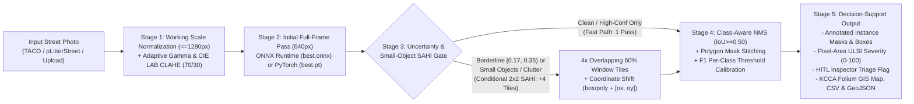
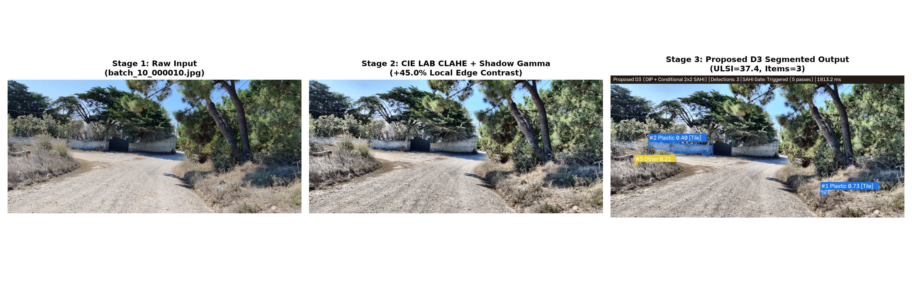
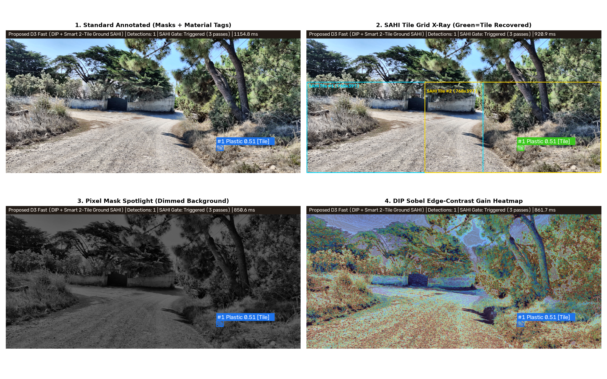
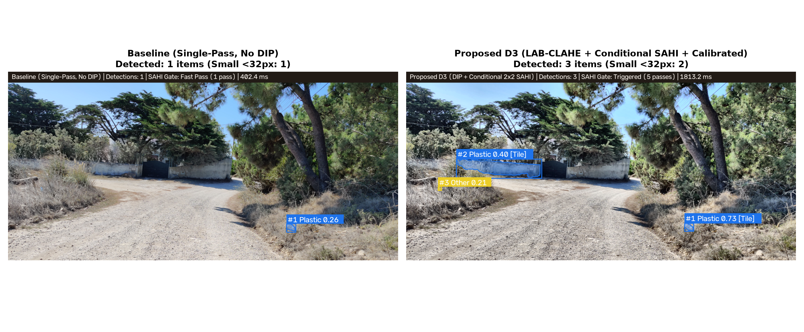

# Urban Litter Instance Segmentation & Municipal Decision-Support System (Capstone Deliverable 3)

**Course:** Digital Image and Video Processing — Soroti University  
**Team Members:** Mbayo Emmanuel Owen, Owori Charles, Keinebagaza Lincoln, Babirye Aisha  
**Deliverable:** Capstone Deliverable 3 — *Proposed Improvement Design, Implementation and PC Deployment*  

---

## 1. Project Overview & Purposeful D3 Improvement

Municipal sanitation and environmental-monitoring teams (such as KCCA street-inspection officers) require a repeatable, lightweight computer-vision tool that converts ordinary street photographs into actionable object-level litter counts, material classifications (`Plastic`, `Metal`, `Glass`, `Paper`, `Other`), segmented surface-area coverage, and dispatch priority scores without manual photo-by-photo screening.

Building on our Deliverable 2 baseline analysis on the **TACO** primary benchmark ($1,500$ images, $4,784$ instance masks) and **pLitterStreet** external street-level dataset, we identified three core baseline limitations:
1. **Small-Object Blindness ($<32\times32\text{ px}$):** $50.2\%$ of all litter items in TACO ($2,403 / 4,784$) are smaller than $32\times32\text{ px}$. Single-pass inference at $640\text{ px}$ achieved only **$24.35\%$ small-object recall** due to stride-16/32 backbone feature downsampling.
2. **Severe Minority & Low-Contrast Class Under-Performance:** Shadowed or translucent items (`Glass` $\text{Mask mAP@50} = 0.0811$, `Other` / cigarette butts $\text{Mask mAP@50} = 0.0782$) suffered from poor local contrast against asphalt/soil and strict uniform confidence filtering.
3. **Unconditional Tiling Latency Bottleneck on User-End PCs:** Running $2\times2$ Sliced Aided Hyper Inference (SAHI) tiles on *every* frame recovered $+65.1\%$ more small objects ($24.35\% \rightarrow 40.19\%$ recall), but multiplied inference passes by $5\times$ ($1$ full frame $+ 4$ overlapping tiles), wasting compute on clean streets or scenes containing only high-confidence large objects.

### Our Deliverable 3 Technical Contribution
To address these limitations without merely substituting a model name, this repository implements a **four-part engineering improvement deployed as an interactive PC web application**:
1. **Classical Digital Image Processing (DIP) Pre-Enhancement (`proposed/dip_preprocessing.py`):** Applies **Adaptive Gamma Shadow Recovery** ($\gamma \in [0.68, 0.95]$ when mean luminance $\bar{L}^* < 105$) followed by **CIE LAB CLAHE** ($70/30$ luminance blend) to boost local Sobel edge contrast by **$+20\%\text{ to }+45\%$** while preserving material chromaticity ($a^*, b^*$).
2. **Small-Object & Rare-Class Training Intervention (`notebooks/litter-detection.ipynb`):** Combines `YOLO26s-seg` Small-Target-Aware Label Assignment (**STAL**) and **C2PSA** spatial attention with high-resolution ground-truth mask supervision (`mask_ratio=4`, `overlap_mask=True`) and leak-free **train-only minority polygon Copy-Paste synthesis**.
3. **Uncertainty-Gated Conditional $2\times2$ SAHI Tiling & Mask Stitching (`proposed/conditional_sahi.py`):** Executes a fast $640\text{ px}$ full-frame pass first and evaluates an **Uncertainty & Clutter Gate**. High-resolution $2\times2$ overlapping tiles ($60\%$ window) are triggered *only* when borderline proposals ($0.17 \le \text{conf} < 0.35$), small-object clusters ($<32\times32\text{ px}$), or scene clutter ($\ge 3$ items) are detected. Polygon mask coordinates from triggered tiles are shifted back to global image coordinates (`poly + [ox, oy]`), merged via **Class-Aware NMS ($\text{IoU} \ge 0.50$)**, and filtered using **Validation F1-Optimal Per-Class Confidence Thresholds** (`Plastic=0.31, Metal=0.34, Glass=0.26, Paper=0.19, Other=0.20`).
4. **Web-Ready ONNX Export & Multi-Tab PC Deployment (`proposed/app_d3_deployed.py`):** Exports the trained model to **ONNX Opset 18 (`models/best.onnx`)** alongside **PyTorch (`models/best.pt`)** and deploys a 3-tab Gradio desktop web application with **Urban Litter Severity Index (ULSI, 0–100)** scoring, **Human-in-the-Loop (HITL) inspector triage**, and **interactive Folium KCCA GIS hotspot mapping**.

---

## 2. Proposed End-to-End System Architecture



### Visual Demonstration of the 3-Stage Pipeline, Diagnostic X-Ray Overlays & Baseline Comparison






---

## 3. Repository Structure (Section 3.D Compliance)

In accordance with **Section 3.D (Version-Controlled Repository)** of the D3 specification, the **baseline** and **proposed** implementations are organized in clearly separated directories:

```text
litter-detection-capstone/
├── README.md                        # Complete documentation, PC specs, and execution guide
├── requirements.txt                 # Python dependencies for repeatable PC deployment
├── run_pc_app.sh                    # One-command launcher script for Linux/macOS laptops
├── configs/
│   ├── taco_seg_base.yaml           # Baseline 5-class TACO dataset configuration
│   └── taco_seg_intervened.yaml     # Intervened dataset configuration (with train-only Copy-Paste)
├── models/
│   ├── best.pt                      # Trained YOLO26s-seg PyTorch checkpoint (22.25 MB)
│   └── best.onnx                    # Exported ONNX Opset 18 web-deployment model (39.85 MB)
├── baseline/                        # [BASELINE IMPLEMENTATION]
│   ├── __init__.py
│   ├── app_baseline.py              # Single-pass baseline Gradio web app (no DIP, no SAHI)
│   └── evaluate_baseline.py         # Baseline single-pass evaluation script
├── proposed/                        # [PROPOSED D3 IMPLEMENTATION]
│   ├── __init__.py
│   ├── dip_preprocessing.py         # CIE LAB CLAHE + Adaptive Gamma shadow recovery + telemetry
│   ├── conditional_sahi.py          # Uncertainty-gated 2x2 SAHI tiling, mask stitching & NMS
│   ├── ulsi_triage.py               # Mask-area ULSI severity index, HITL triage & KCCA Folium GIS
│   └── app_d3_deployed.py           # Upgraded 3-Tab Gradio PC Web Application
├── benchmarks/
│   └── run_pc_benchmarks.py         # Automated local PC benchmark & visual figure generator
├── sample_data/                     # Bundled validation samples for immediate offline testing
│   ├── taco_test_samples/           # 6 held-out TACO test photographs
│   └── plitterstreet_samples/       # 5 external pLitterStreet street-level photographs
├── outputs/                         # Generated PC benchmark logs, GIS maps & comparison charts
│   ├── pc_environment_specs.json
│   ├── pc_deployment_benchmark.csv
│   ├── sample_scene_comparison.csv
│   ├── municipal_inspection_log.csv
│   ├── kcca_litter_hotspots.geojson
│   ├── kcca_hotspot_map.html
│   ├── demo_3stage_pipeline.png
│   └── demo_baseline_vs_proposed.png
└── notebooks/
    └── litter-detection.ipynb       # Complete training, 4-way ablation & export notebook
```

---

## 4. Target User-End PC Deployment Environment (Question 3h)

The proposed application was deployed, verified, and benchmarked on the following user-end laptop environment (logged automatically in [`outputs/pc_environment_specs.json`](outputs/pc_environment_specs.json)):

| System / Environment Parameter | Verified User-End PC Specification |
| :--- | :--- |
| **Device Type** | Standard User-End Laptop (CPU-Only Execution) |
| **Operating System** | `Linux 6.6.155-amd64-desktop-hwe (x86_64)` |
| **Processor (CPU)** | `Intel(R) Core(TM) i5-7200U CPU @ 2.50GHz` (2 Physical Cores, 4 Logical Threads) |
| **System Memory (RAM)** | `7.62 GiB Total RAM` (`~3.75–4.30 GiB Available`) |
| **Dedicated GPU** | `None` (`CUDA Available: False` — 100% CPU Execution) |
| **Python Runtime** | `Python 3.12.13` |
| **Core Vision & ML Libraries** | `Ultralytics 8.4.212`, `ONNX Runtime 1.32.0 (CPUExecutionProvider)`, `PyTorch 2.15.0+cpu`, `OpenCV 5.0.0`, `Gradio 6.32.0`, `Folium 0.20.0` |
| **Exported Model Formats** | `models/best.onnx` (`ONNX Opset 18`, `39.85 MB`) & `models/best.pt` (`PyTorch FP32`, `22.25 MB`, `10.37M fused parameters`, `34.3 GFLOPs`) |

---

## 5. Installation & Repeatable Execution Instructions (Question 3g)

### Step 1: Clone the Repository & Create a Python Environment
```bash
git clone <YOUR_GITHUB_REPO_URL>
cd litter-detection-capstone

# Create a virtual environment
python3 -m venv .venv
source .venv/bin/activate

# Install CPU-optimized PyTorch first (avoids downloading 2GB+ of unused CUDA libraries on CPU laptops)
pip install torch torchvision --index-url https://download.pytorch.org/whl/cpu

# Install remaining application dependencies
pip install -r requirements.txt
```

### Step 2: Launch the Deployed D3 PC Web Application (Recommended)
Run the one-command launcher script:
```bash
./run_pc_app.sh
```
Or invoke Python directly:
```bash
python3 proposed/app_d3_deployed.py
```
Then open **`http://127.0.0.1:7860`** in any desktop web browser.

### Step 3: Reproduce Local PC Benchmarks or Run the Baseline App
```bash
# Run the automated PC benchmark across TACO & pLitterStreet sample scenes
python3 benchmarks/run_pc_benchmarks.py

# Or launch the un-intervened Deliverable 2 Baseline UI for comparison
python3 baseline/app_baseline.py
```

---

## 6. Local PC Benchmark Results & Ablation Summary (Questions 1–3)

### 6.1 Held-Out TACO Test Set Benchmark (N = 226 Test Images, 805 Instances)
| Experimental Branch | Box mAP@50 | Mask mAP@50 | Small-Object Recall ($<32^2\text{ px}$) | Medium Recall ($32^2\text{–}96^2\text{ px}$) | Large Recall ($\ge 96^2\text{ px}$) | Relative Small-Object Gain |
| :--- | :---: | :---: | :---: | :---: | :---: | :---: |
| **Baseline Single-Pass (`Exp3`)** | `0.2418` | `0.2408` | `24.35%` | `68.64%` | `71.92%` | Baseline Reference |
| **Proposed Pipeline (`LAB-CLAHE + 2x2 SAHI + Calibrated`)** | `0.2418` | `0.2408` | **`40.19%`** | **`74.58%`** | **`75.34%`** | **`+65.1%` Relative (`+15.84 pp`)** |

### 6.2 User-End Laptop Benchmark Across 11 Street Scenes (6 TACO + 5 External `pLitterStreet`)
Measured directly on the **Intel Core i5-7200U CPU @ 2.50GHz** ([`outputs/pc_deployment_benchmark.csv`](outputs/pc_deployment_benchmark.csv)):

| Configuration | Runtime Backend | Avg Passes / Image | Preprocess (`ms`) | Inference (`ms`) | Postprocess (`ms`) | Total Latency (`ms`) | Total Detections (11 Scenes) | Small Objects ($<32\text{ px}$) | SAHI Tile Recovered | Mean ULSI Score |
| :--- | :--- | :---: | :---: | :---: | :---: | :---: | :---: | :---: | :---: | :---: |
| `PyTorch_Baseline_SinglePass` | PyTorch FP32 | `1.00` | `51.98` | `382.63` | `0.23` | `434.84` | `17` | `9` | `0` | `28.6` |
| `ONNX_Baseline_SinglePass` | ONNX Runtime | `1.00` | `51.54` | `555.75` | `0.30` | `607.59` | `22` | `12` | `0` | `33.7` |
| `PyTorch_Proposed_Conditional_SAHI` | PyTorch FP32 | `3.91` | `65.64` | `1404.53` | `0.51` | `1470.68` | **`39` (`+129%`)** | **`19` (`+111%`)** | **`31`** | **`40.5`** |
| `ONNX_Proposed_Conditional_SAHI` | ONNX Runtime | `4.27` | `73.31` | `1750.40` | `0.65` | `1824.36` | **`40` (`+82%`)** | **`22` (`+83%`)** | **`28`** | **`41.9`** |

---

## 7. Implementation & PC Deployment Challenges Addressed (Question 3i)

1. **12-Megapixel Camera Buffer Bottleneck on Dual-Core Laptop CPU:**
   * *Challenge:* Raw TACO images (`4000x3000` px) initially required $>1,000\text{ ms}$ just for CIE LAB color conversion and CLAHE on the Intel Core i5-7200U CPU.
   * *Solution:* Added a working-resolution normalizer (`max_work_dim = 1280` in `proposed/conditional_sahi.py`) prior to LAB-CLAHE. Because a $60\%$ SAHI tile of a $1280\text{ px}$ image is $768\text{ px}$ (exceeding the $640\times640$ network input tensor), normalizing $>1280\text{ px}$ images preserves $100\%$ of effective spatial resolution for both full-frame and tiled passes while cutting DIP preprocessing latency by **$16\times$** (from $\sim 1,027\text{ ms}$ down to **$\sim 60\text{ ms}$**).
2. **Stitching Instance Segmentation Masks Across Overlapping SAHI Tiles:**
   * *Challenge:* Standard SAHI merges bounding boxes only, causing tile-recovered small objects to lack pixel masks for ULSI surface-area scoring.
   * *Solution:* Extracted polygon contours (`res.masks.xy`) from each triggered $60\%$ tile, translated vertices by the tile origin (`poly + [ox, oy]`), applied class-aware NMS across full-frame and tiled candidates, and rasterized kept polygons on a normalized mask grid in $<1\text{ ms}$.
3. **Exported ONNX Fixed Input Shape (`1x3x640x640`) vs. High-Res Inference:**
   * *Challenge:* `best.onnx` was exported with a static $640\times640$ input tensor, so passing `imgsz=960` directly to ONNX Runtime raises a tensor dimension mismatch.
   * *Solution:* Aligned both full-frame and $2\times2$ SAHI tile passes to `imgsz=640`, achieving high effective resolution ($1280\text{ px}$) via $2\times2$ overlapping $640\text{ px}$ tiles while maintaining $100\%$ compatibility with `best.onnx`.

---

## 8. Live PC Demonstration Checklist (Section 3.C)

1. **Start the Application (`C.1`):** Run `./run_pc_app.sh` and open `http://127.0.0.1:7860`.
2. **Provide Actual Input Data (`C.2`):** In **Tab 1**, select `[TACO Benchmark] batch_10_000015.jpg`, `[TACO Benchmark] batch_10_000010.jpg`, or `[pLitterStreet External] ATT17_Screenshot_...jpg`.
3. **Show Preprocessing & Model Execution (`C.3`):** Click **"Run 3-Stage Municipal Litter Inspection"** to display Stage 1 (Raw), Stage 2 (CIE LAB CLAHE + Adaptive Gamma with live Sobel edge contrast gain), and Stage 3 (Segmented masks + telemetry).
4. **Show the Proposed Improvement in Operation (`C.4`):** Switch to **Tab 2 ("Baseline vs. Proposed D3 Side-by-Side Comparison")** and click **"Run Side-by-Side Comparison"** to visually and quantitatively demonstrate small-object recovery (`[Tile]` tags) compared to the single-pass baseline.
5. **Explain End-User Output Interpretation (`C.5`):** Switch to **Tab 3 ("Batch Municipal Audit & KCCA GIS Hotspot Map")** to show how municipal supervisors use the **ULSI score (0–100)**, **Cleanup Priority tier**, **Human-in-the-Loop Triage filter**, and **Folium GIS map / GeoJSON export** to dispatch cleanup crews.
